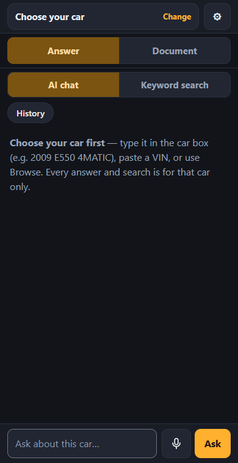

# AutoRundown

Turn a local archive of vehicle service manuals into a searchable, AI-queryable
repair reference that runs entirely on your own machine.

Ask *"torque for the front brake caliper anchor plate bolts"* and get the value,
the page it came from, and the diagram — for any vehicle in your archive.

**AutoRundown ships no manual content.** You point it at documents you already
have.


<p align="center"></p>

*Keyword search (free, no API key) over the built-in sample data. The manual
text in these recordings is invented sample data, not from any real manual;
`python tools/readme_gifs.py` records them again.*

An AI answer reads like this (text output of `ask.py`):

```
SPECIFICATION
  Front Brake Caliper Anchor Plate bolts (2 bolts, discard after removal)
  184 lb.ft (250 Nm)
  Front Disc Brake System — 2015 F-150
  [page 6706]

SOURCES
  p6706  Front Brake Caliper Anchor Plate: Removal
  p6709  Front Disc Brake: Removal
```

---

## Why it refuses to guess

A confident wrong torque value is worse than no answer. Two mechanisms enforce
that:

**Citations are verified, not trusted.** The model is told to cite its sources,
but instruction is not proof. Every page and figure it cites is checked against
what retrieval actually returned. Anything else is dropped, and an answer left
with no surviving citation is withheld rather than shown.

**Vehicle filtering happens before ranking, not after.** A spec from the wrong
year or engine can never outrank the right one, because it is never a candidate
in the first place.

"Not found in this archive" is a correct and useful answer here, and the tool is
built to prefer it over a plausible guess. A withheld answer says so instead —
"No checked answer — the AI's sources couldn't be verified" — with a button
that runs the same question as a (free) keyword search.

---

## Install

### Windows: the installer

Download `AutoRundown-<version>.msi` from the repo's
[Releases](https://github.com/Cquester/AutoRundown/releases) (each new
version on `main` publishes one, with a `.sha256` beside it) and
double-click it. It needs no admin rights and no Python. It installs for your
user only, in `%LOCALAPPDATA%\Programs\AutoRundown`, and adds AutoRundown to
the Start menu and desktop. The installer asks whether to **start AutoRundown
when you sign in** (ticked by default) and, on the last page, offers to
**launch it now** -- so after installing it is running, with no window to
keep open. A silent install (`msiexec /i AutoRundown-<version>.msi /qn`)
turns sign-in start on too; add `AUTOSTART=0` to leave it off.

Starting AutoRundown opens your browser; the server runs in the background
with an **AR icon in the tray** (bottom-right, maybe under the ^ arrow):
click it to open AutoRundown, right-click for *Start when I sign in* and
*Stop AutoRundown*. The same option is under **Shop setup → This PC**.
The first time, Windows Firewall asks whether to allow it on private
networks: allow it to use AutoRundown from a phone on your wifi, or decline
to keep it on this PC only. With no manuals indexed yet, AutoRundown opens a
short *Set up AutoRundown* checklist: add manuals (required), then an API key
and phones (both optional). All of it lives under **⚙ Shop setup**
afterwards: Manuals, AI answers, Phones & mechanics, This PC, Advanced.

**On your phone:** open **http://autorundown.local:8756** (same wifi), then
*Add to Home Screen* -- it opens like an app. AutoRundown announces that name
on your network itself (mDNS, like a printer), so it keeps working when the
PC's IP address changes, with no router setup. iPhones support it; Android
does in recent versions of Chrome. If the name doesn't open (some guest or
mesh networks block it), Shop setup → *Phones & mechanics* shows the numeric address,
and a QR code that opens it from the phone's camera; to keep that
one from changing, reserve the PC's IP in your router's DHCP settings
("address reservation" / "static lease").

It is not a Windows service on purpose: a service would need admin rights
and run as a system account that can't see your VirtualBox VMs or your
files. "Start when I sign in" runs it as you, in the background.

- **"Windows protected your PC"**: the installer is not code-signed yet. Click
  *More info* -> *Run anyway*.
- **Your data is not in the install folder.** The index, settings and spend
  log are in `%USERPROFILE%\.autorundown`. Upgrading (just run a newer
  `.msi`) or uninstalling (Settings -> Apps) never touches them.
- **Importing from a Mercedes VM** uses your own copy of the WIS extractor
  (it needs the Mercedes software next to it, so it can't be part of the
  installer). It is found automatically at `Desktop\Mercedes Documents\autorundown_extractor`;
  anywhere else, set it under Shop setup → *Advanced* → *Mercedes extractor folder*.
  The installer includes the Python packages it needs. The same tab can pull
  the **EPC parts catalogue** (*What to extract* → *EPC*): part
  numbers and exploded drawings then show under each car beside its manual.
  *Both* runs WIS and then EPC as one job (EPC is not started if WIS fails);
  a progress bar under the tab shows the step, phase and counts, and comes
  back after a page reload.
  **Choose the VM** first: the tab then checks what the run needs (network,
  Java, the extractor's scripts, disk space) and lists anything missing.
  **Test the VM** boots it, checks Windows starts and the database answers,
  and shuts it down. **Cancel** stops a run and shuts the VM down cleanly; a
  re-run resumes. The VM is never switched off by force: if Windows doesn't
  start, the tab shows a picture of the VM's screen and the VM is paused
  there for you to open in VirtualBox.
  **After updating AutoRundown, update the extractor copy too** (copy a
  current extractor folder over it): the check says so when it's too old.
  **If your manuals are already extracted**, skip the VM: Shop setup → *Manuals* → the *Folder* tab,
  and pick `Mercedes Documents\autorundown_out\wis_extract`.
- The command-line tools are installed too:
  `"%LOCALAPPDATA%\Programs\AutoRundown\python\python.exe" "%LOCALAPPDATA%\Programs\AutoRundown\app\ask.py" --usage`.

To build the installer yourself, see `packaging/windows/build.ps1`.

### macOS and Linux: run from source

There is no installer for these yet. Install Python and run the commands
below. Everything works the same, including the phone access.

### Requirements (running from source)

- Python 3.10+
- An API key from one AI provider (yours — billing and rate limits are
  yours): [Anthropic](https://platform.claude.com/settings/keys) (the
  default), [Google Gemini](https://aistudio.google.com/apikey),
  [xAI](https://console.x.ai/team/default/api-keys) or
  [DeepSeek](https://platform.deepseek.com/api_keys). Shop setup → *AI
  answers* has a "Get a key" button for each.
- A local archive of service manuals you have the right to use

No OCR engine, no GPU, no vector database, no cloud services beyond the LLM call.

> **API credit is billed separately from a Claude Pro/Max subscription.** A
> balance shown against a subscription cannot pay for API calls. Top up at
> [console.anthropic.com/settings/billing](https://console.anthropic.com/settings/billing).
> If your key is valid but unfunded you get a clear message, and keyword search
> keeps working regardless.

---

## Quick start (from source)

```bash
git clone https://github.com/Cquester/AutoRundown.git
cd AutoRundown
python3 -m venv .venv && source .venv/bin/activate   # Windows: .venv\Scripts\activate
pip install -r requirements.txt
```

(On macOS, `python3` comes with the Xcode command-line tools or from
python.org. On Linux, use your distribution's `python3` and `python3-venv`.)

Build the index from your archive directory:

```bash
python ingest.py --archive /path/to/your/manuals --index index.db
```

Indexing is resumable — interrupt it and re-run, and it picks up where it
stopped. `--force` rebuilds from scratch.

Start the server:

```bash
python serve.py
```

It prints a `localhost` URL and a LAN URL. The LAN one works from a phone on the
same wifi — same responsive UI, no app to install, no native build. Add it to
your home screen and it opens like an app.

Add manuals and your API key under **⚙ Shop setup** (the first start walks
you through it), or set the key in the environment:

```bash
export ANTHROPIC_API_KEY="sk-ant-..."
```

Keys are stored in `~/.autorundown/config.json` (override the location with
`AUTORUNDOWN_HOME`) and are sent only to Anthropic.

### Trying a change without touching your real setup

```bash
python dev.py            # opens http://localhost:8757 with sample data
python dev.py --empty    # starts with no index: the first-start setup checklist
python dev.py --reset    # throw the dev data away and start over
```

A separate, throwaway AutoRundown: its own settings, accounts and index in
`.dev/` (never your real `~/.autorundown`), on port 8757 so it can run next
to the real one, and reachable only from this PC. The sample manuals are
invented text — never use a value from them on a car. No API key is copied in,
so nothing costs money unless you add one.

### In a shop: who can use it

**The PC running AutoRundown is the admin.** Shop setup -- the API key,
imports, removing manuals and mechanics' accounts -- is only available in a
browser *on that PC* (`http://localhost:8756`). Phones and other computers
can search and ask, nothing else -- they never see Shop setup, and the server
refuses those requests from them.

**Mechanic accounts are optional.** Shop setup → *Phones & mechanics* →
*Require each mechanic to sign in*. Then:

- On the same page, add a mechanic's name (and, if you like, a monthly
  dollar limit). Their **sign-in QR** opens on the PC's screen.
- The mechanic scans it with their phone's camera: the phone opens
  AutoRundown already signed in, and stays signed in (a year, or until you
  sign it out). The QR works once, for 15 minutes, and stops working when
  you close it. A phone whose camera can't scan it types the 8-character
  code shown under the QR instead (same rules). A new phone later: the
  mechanic's **Sign-in QR** button.
- Lost phone or someone leaves: **Sign out devices** or **Disable**. It takes
  effect immediately.
- Every paid question is logged against the mechanic who asked; the same
  page shows each one's questions and dollars this month, with a bar against
  their limit, and the mechanic sees their own by tapping their name on the
  phone. `python ask.py --usage` lists it by user. Over the limit, asking is
  refused; keyword search keeps working.
- The top of the page has a QR that just opens AutoRundown, with its
  addresses written beside it.

**Who pays for AI answers** (Shop setup → *AI answers*):

- **One company key** (the default): every question goes on the key you
  saved; the page shows this month's total for everyone.
- **A key per mechanic**: you make one API key per mechanic at the
  provider's key page ("Get a key") and enter it there with the credit you loaded on
  it. Each mechanic's questions go on their own key; the page shows what was
  spent on it and roughly what is left. *Left* is AutoRundown's own estimate
  (the amount you entered minus what it logged on that key) -- the provider
  doesn't tell an ordinary key its balance -- so after adding credit or
  swapping the key, use **Topped up / new key**. A mechanic with no key is
  told so; their questions never go on another key. Questions asked on the PC
  itself still use the PC's key.

**From the phone to the desk.** Pick the car on a phone in the bay -- type
it, Browse, or type or paste its VIN -- and tap **Send this car to the desk**.
The PC shows *Car waiting from Daxton: 1987 Mercedes-Benz 190 E 2.3 16 (VIN
…) -- Open*; Open picks the same car, model and engine there, ready for the
big-screen diagrams and parts views. The PC lists the latest five from every
mechanic; a mechanic's other devices see only their own. Cars disappear
after 24 hours, when opened, or with the ×. With sign-in off there are no
names: a car sent from a phone that isn't signed in also shows on every
other device on the network that isn't signed in (the phone says so under
the button).

With sign-in off, anyone who can reach the PC on the network can search and
ask (on your API key), as before. Either way, also keep customers off that
network: put the PC on the staff network, not the guest wifi (most routers
isolate guest-wifi devices from everything else).

### HTTPS on the shop network

```bash
python serve.py --https
```

No public certificate authority will sign for an address like
`192.168.1.20`, so AutoRundown makes its own small one, once, in
`~/.autorundown/tls/`, and issues a certificate for this PC's addresses
(re-issued by itself when the PC's address changes). Each phone installs the
authority once from `https://<PC address>:8756/ca.crt`:

- **iPhone/iPad:** open that link in Safari → Allow → Settings → *Profile
  Downloaded* → Install; then Settings → General → About → *Certificate Trust
  Settings* → turn it on.
- **Android:** download it, then Settings → Security → *Encryption &
  credentials* → *Install a certificate* → *CA certificate*.

Until a phone has it, the browser shows a warning that can be clicked
through; the connection is still encrypted. The authority is restricted to
private addresses and `.local` names, so it cannot be used to impersonate
any real website, even if its key were copied off the PC.

### Command line

```bash
# ask a question
python ask.py --vehicle f-150 "torque for the front caliper anchor plate bolts"

# keyword search — no API call, no key needed, costs nothing
python ask.py --vehicle f-150 --search "caliper anchor plate"

# what have I spent?
python ask.py --usage

# list indexed vehicles
python ask.py --list
```

---

## What you can look up

One question fills every source at once. The answer (or, for **Search**, the
manual's matching pages) stays on the left; the **right box** has a tab for
each source -- on a phone, the bar at the bottom with the short names Manual,
Parts, Labour, Fluids, Torque, each opening the **Document** view. After
**Ask**, every tab is searched with the same search terms the AI made from
your question; after **Search**, with the words you typed. That is a keyword
search, not another AI call, so the tabs cost nothing, and each tab shows how
many results it has (a tab with none is dimmed). Always within the car you
chose:

| Tab | Shows |
|---|---|
| **Manual page** | The page the answer points at, or any page you open. |
| **Parts** | The Mercedes parts catalogue (EPC), when imported: each page's matching part lines -- number, name, which models it fits and how many, supersessions and footnotes ("up to engine 32946334"). |
| **Labour times** | Mercedes flat-rate times for the exact model (WIS). |
| **Capacities** | The engine oil figure for your engine (WIS), and capacity lines from the car's pages. |
| **Torque specs** | Torque lines from the car's pages, each linked to its page. |

Lines that name only another engine or model are left out, and every line
links to the page it came from: tables often list several engines, so the page
is where you confirm the row is yours. A WIS page opens in **Reading view** or
**Original layout** (the page redrawn from WIS); a parts page opens as its list.

## How it answers

1. Claude rewrites your question into manual terminology
   (*"how much oil does it take"* → `engine oil capacity`).
2. Those queries run against a SQLite FTS5 index, BM25-ranked, scoped to the
   selected vehicle.
3. Results from each query are merged **round-robin**, so a multi-part question
   keeps a share of context for every part rather than letting one sub-question
   crowd out the rest.
4. Claude answers from the retrieved passages only, copying values exactly.
5. Every citation is verified against the retrieved set.

Claude does not retell the manual. An answer is one to three sentences, a
table of the values the job needs, and **the manual page itself, opened beside
the answer**: the procedure for "how do I…", the spec table for "what is the
torque…". The page is the authority; the summary only points at it.

| Field | Holds |
|---|---|
| `document_page` | The one page to open beside the answer (verified like any citation) |
| `specs` | Values only — a torque, a capacity, a clearance — shown as a table |
| `figures` | A diagram on *another* page that the job needs (shown as a link) |
| `caveats` | Applicability warnings, or a genuine conflict between pages |

A value is a number, never *"see Fig 15"*: a picture belongs to its page, which
is one tap away. An answer with no page (not found, or withheld) clears the page
panel to "No manual page for this answer", so an earlier answer's page never
reads as this one's source.

**On a phone** the screen is one column: the car as a single line at the top
(tap **Change** for the car box, Browse, VIN, the scope note and Options, full
screen), **Answer | Document** under it, the question docked at the bottom with
**Ask** and a magnifier for the keyword search, and the right box's tabs as a
bottom bar (Manual, Parts, Labour, Fluids, Torque; a tap opens that tab in
**Document**). An answer's page loads into
**Document** (a dot says one is waiting) and opens with *Open manual page*;
the phone's Back, or a swipe to the right, returns to the answer.

**Recent cars.** Clicking into the car box (on a phone: tapping **Change**)
lists the last ten cars picked on that device, newest first -- one tap, or the
arrow keys and Enter, picks one again with the same model, engine and year it
had. Each row has a **×** to drop it, and **Clear history** empties the list.
The list is kept in that browser only, so each phone in the shop has its own;
typing in the box replaces it with the usual suggestions.

**Scan VIN.** In the car sheet (or the VIN dialog, Browse → VIN) **Scan VIN**
opens the phone's camera: photograph the VIN label, its barcode (Code 39 on
the door jamb, Data Matrix or QR on newer labels) or the VIN plate. The photo
is read on the phone itself — a barcode reader and OCR, no AI, nothing
uploaded, no internet needed (the libraries ship with AutoRundown, ~5 MB
fetched by the phone the first time). What was read fills the VIN box with
the part of the photo it came from; check it against the car and tap
**Find**. Every VIN — typed, pasted or scanned — is checked first: I, O and
Q are refused with the 1/0 fix offered, and a US VIN whose check digit
(position 9) doesn't match gives only the model series, never an exact
model or engine, because one wrong character can name another car.

Citations name the page rather than just numbering it — `p6706 · Front Brake
Caliper Anchor Plate: Removal`. Titles are resolved locally from the index, so
they cost no tokens and cannot be invented.

### Following the wiring

Two kinds of link are reconstructed in the source pane, both free — no API
call is involved in either.

**The manual's own cross-references.** "Refer to: Interior Lamps for schematic
and connector information" was a real link in the source HTML. Those are
preserved and clickable, plus listed under "Referenced pages".

**Connector IDs.** `C906` appears as bare text, but the archive files its
pinout and its physical location on two separate pages. Those are indexed by
id at ingest, so any mention becomes a chip: click it and you get one card
with the connector end view (pin numbers, wire colours, circuit functions,
pigtail part numbers) above the harness routing diagram showing where it sits
on the vehicle.

Only ids that actually resolve to pages are linked — matching the `C###`
pattern blindly would turn DTC codes and table data into dead links. This is
archive-dependent: the tested Ford manual yields 529 connectors, while a 1987
Mercedes manual predates the format and yields none, in which case no chips
appear and nothing else changes.

### Why keyword search rather than embeddings

Manual text is dense with exact terms — part names, `3.5L`, `coil-on-plug`,
`anchor plate` — which is where BM25 is strong and pure vector search is weak.
Letting Claude choose the search terms recovers the natural-language phrasing
embeddings would have given, without a multi-gigabyte model download or an
embedding pass over every chunk.

If retrieval starts missing on vague questions, that is the point to add vectors
alongside BM25 — not before.

---

## Choosing an AI provider

Shop setup → *AI answers* → **AI provider**: Anthropic (Claude, the
default), Google Gemini, xAI (Grok) or DeepSeek. Each has a **Get a key**
button that opens that provider's API-key page: sign in and create a key,
copy it, paste it in. Keys are kept per provider, so switching back and
forth loses nothing; in "A key per mechanic" mode each mechanic needs a key
for the provider in use.

Whichever provider answers, the answer goes through the same checks: every
value and page must be one the search actually returned, values for other
engines of the car are hidden, and an answer left with nothing behind it is
not shown. Answers were tuned and evaluated on Claude; the other providers
have been tested only against a stand-in (no paid question yet), so try one
before relying on it.

**Gemini's free tier**: Google offers Gemini Flash and Flash-Lite free of
charge with low request limits (not Gemini 4 Argon). On the free tier Google
says it may use what is sent to improve its products -- here, your questions
and the manual pages sent with them; with billing turned on it does not.
Check [Google's pricing page](https://ai.google.dev/gemini-api/docs/pricing)
for the current terms.

## Choosing a model

Pick it from the toolbar beside the question box; it applies to the next
question immediately and saves the choice on that device. The PC's default
is under Shop setup → *AI answers*; on the command line, `ask.py --model`
(any provider's model; its company key pays).

Prices as listed by each provider on 2026-10-16 (USD per million tokens):

| Model | Price /M in–out | Per question | Eval |
|---|---|---|---|
| `claude-opus-5` | $5 / $25 | ~$0.05 | — |
| `claude-sonnet-5` | $2 / $10 | ~$0.02 | 7/7 |
| `claude-haiku-4-5` | $1 / $5 | ~$0.01 | 7/7 |
| `gemini-4-argon` | $2 / $10 ($4 / $20 from 2026-12-01) | ~$0.02 | — |
| `gemini-3.8-flash` | $0.75 / $3.75 ($1.50 / $7.50 from 2027-01-01) | ~$0.008 | — |
| `gemini-3.5-flash-lite` | $0.30 / $2.50 | ~$0.004 | — |
| `grok-4.7` | $2 / $6 | ~$0.02 | — |
| `grok-4.3` | $1.25 / $2.50 | ~$0.01 | — |
| `deepseek-v4-pro` | $1.32 / $3.96 peak, half off-peak | ~$0.01 | — |
| `deepseek-flash` | $0.30 / $1.20 peak, half off-peak | ~$0.003 | — |

The spend log records the provider and model of every question
(`python ask.py --usage`). A model whose price AutoRundown doesn't know is
logged as "cost not tracked" rather than with a made-up number.

Retrieval does the finding, so the model's remaining job is reading passages and
copying values exactly — which Haiku handles well at roughly half of
Sonnet's cost.

One difference the eval does not capture: when the same spec is printed on
several pages in several units, Sonnet reliably folds it into one entry citing
every page, while Haiku tends to split it into two entries for the same
fastener. Both are correct; Haiku is just noisier to read.

Diagnostic questions ("why is X not working") pull far more pages into context
than a spec lookup and cost proportionally more — expect $0.07–$0.10 on Sonnet
versus ~$0.03 for a torque value.

Request parameters adapt per model: Haiku 4.5 predates adaptive thinking and the
effort setting, so those are omitted rather than sent and rejected.

---

## Validation

```bash
python eval.py           # free — no API calls
python eval.py --answers # spends credit, prints an estimate first
python eval.py --answers --case caliper-anchor-torque --model claude-haiku-4-5
```

The default check is free and catches indexing, dedup, ranking, and
variant-filter regressions — most of what actually breaks. The answer check is
opt-in, announces its estimated cost, prints a running total so a Ctrl-C still
tells you what was spent, and can be scoped to a single case and a cheap model.

Run the paid check after changing prompts, retrieval, or models — not routinely.
It has already caught a prompt tweak that fixed one problem while silently
breaking another.

The rest of the checks are free and need no real manuals -- they build
their own small corpora:

```bash
python tests/test_records.py      # any of tests/test_*.py; CI runs them all
python eval_wis.py                # Mercedes WIS retrieval + wrong-vehicle guards (real index)
```

Contributors: `tools/container/README.md` starts a throwaway test box (Docker
in WSL, sample data, no network) and runs every CI check inside it.

**The shipped cases are archive-specific** — they cite page numbers from one
particular manual set and will not pass against a different archive. Replace
them with known answers from your own: look a spec up by hand, note its page,
add an entry. A handful is enough to catch what matters.

Every paid question is logged with its source (`web` / `cli` / `eval`), model,
tokens, and cost, so spend can be attributed after the fact rather than guessed
at.

---

## Adding a new archive format

Everything downstream reads one normalized shape, so supporting a new archive
layout is a single file. Subclass `Importer`, emit `VehicleRecord` and
`PageRecord`, and register it:

```python
@register
class MyImporter(Importer):
    name = "my-archive"

    @classmethod
    def detect(cls, root): ...      # recognize the layout
    def discover(self, root): ...   # yield VehicleRecord
    def pages(self, vehicle): ...   # yield PageRecord
```

Indexing, search, the query layer, and the UI need no changes.

Three importers ship:

- **`lemon`** — HTML manual archives (one directory per vehicle, `pages/*.html`
  plus `images/`).
- **`records`** — a normalized corpus (`records.jsonl` + `manifest.json`, the
  contract in [`extractor/IMPORT_SPEC.md`](extractor/IMPORT_SPEC.md)). The
  Mercedes WIS extractor in `extractor/` writes one from your own licensed WIS
  installation; any other source can do the same and needs no code here.
- **`folder`** — generic fallback for a plain directory of HTML, text, or PDF,
  inferring what metadata it can from paths. PDF support needs
  `pip install pypdf`.

All three can be run from Shop setup → *Manuals*, which detects which one a
folder needs.

---

## Design notes

Findings from building this that are worth knowing before you extend it.

**HTML archives need no OCR.** The obvious design for scanned manuals puts OCR
at the center — layout-aware table detection, bounding boxes, long resumable
runs. If your archive is already HTML, none of that applies: spec tables are
real `<table>` elements, so row/column association survives intact and a
torque-angle spec like `Stage 1: 62 lb.in (7 Nm), Stage 2: 50°` is preserved
verbatim. Indexing is minutes, not hours. The OCR stage is deliberately absent;
if you point this at genuine scans, that is the piece to add, and the importer
interface is where it plugs in.

**Archives duplicate themselves.** The tested archive files each article under
several folders — roughly 3.2 copies each. Indexed naively, the top 10 results
were really 3 distinct answers repeated. Pages are deduplicated by content hash;
the first copy is indexed and later copies point at it, so citations always name
a canonical page.

**One manual can contain several engines.** A 3.5L manual may also carry pages
for the 2.7L and 5.0L variants — thousands of them. Answering a torque question
from the wrong engine's page is the exact failure this tool must not have, so
such pages are flagged at import and excluded from search by default. A toggle
reveals them, labelled.

Residual risk: some sibling-engine pages sit in the main tree identified only by
their title. The prompt requires stating exact applicability and flagging any
mismatch, but check the cited page when the spec matters.

**Keep the manual's own cross-references.** Manual text is full of "Refer to:
Interior Lamps for schematic and connector information", where the name was a
link to another page. Strip the `href` and you leave a dead reference the
reader can see but not follow — which is precisely the trail needed when
chasing a connector during diagnosis. Roughly half the pages in the tested
archive carry such links. They are preserved as inline markers, rendered as
clickable cross-references in the source pane plus a "Referenced pages" list,
and stripped before the text reaches the model — showing them would invite
citing a page whose content was never retrieved.

**Diagram paths vary.** Images may be flat (`images/GFD41117.jpeg`) or nested
(`images/IMP49Q313/euro210/551068321.png`). References are kept relative to
`images/` rather than reduced to a filename, or nested ones cannot be resolved.
UI chrome under `icons/` is also served as `` and is excluded. A flat
archive hides this bug completely.

Measured on two vehicle archives (~46k source pages, ~865 MB of HTML and
images): 16,034 unique pages after dedup, 21,401 searchable chunks, 189 MB
index, 39 seconds to build.

---

## Project layout

```
autorundown/             the app (everything the installer ships)
  importers/             archive-specific code lives ONLY here
    base.py                Importer interface + normalized records
    lemon.py               LEMON HTML archives
    records.py             normalized corpus (records.jsonl), e.g. Mercedes WIS
    folder.py              generic fallback (HTML / text / PDF)
    data/                  hand-made reference tables (years, engines, LEMON catalogue)
  extract.py             HTML -> text, tables -> pipe tables
  index.py               SQLite FTS5 schema, chunking, dedup, connectors, usage log
  search.py              BM25 retrieval with mandatory vehicle filter
  synonyms.py            shop words -> the manuals' words ("valve cover")
  query.py               Claude planner + answerer + citation verification
  server.py              local web server (FastAPI)
  auth.py                the PC is admin; optional mechanic accounts, sign-in QRs
  handoff.py             cars sent from a phone to the desk ("Send this car to the desk")
  qr.py                  QR codes as SVG (segno)
  tls.py                 local certificate authority for --https
  importer_jobs.py       imports started from Shop setup
  lemon_catalogue.py     the LEMON catalogue tree
  wis_links.py           WIS cross-references, wiring-diagram hotspots, codes, labour
  wis_original.py        WIS "Original layout" view
  launcher.py, autostart.py, mdns.py   Windows tray, start at sign-in, autorundown.local
  web/index.html         the whole UI, one responsive page

serve.py                 start the server
ingest.py                build / update the index
ask.py                   command-line questions, keyword search, spend
rebuild_wis.py           replace the Mercedes WIS part of the index in place (keeps other manuals and the spend log)
remove_manuals.py        remove a manual (or all Mercedes WIS) from the index
dev.py                   throwaway local instance with sample data (port 8757)
eval.py, eval_wis.py     retrieval checks against a real index (free)

tests/                   free test suites (python tests/test_<name>.py)
tools/                   sample-data makers, README screenshots, JS check, catalogue builders
  container/             test boxes: the app in Docker with sample data, no network
  sandbox/               a fresh install of the MSI in Windows Sandbox
extractor/               Mercedes WIS extractor (reads your own licensed install)
packaging/windows/       the MSI (WiX) and its first-start UI check
docs/                    setup on a new PC, WIS extraction notes, QA reports, images
```

---

## Non-goals

No ads. No hosting or redistributing manual content. No native mobile app. No
multi-tenant cloud version.

---

## Safety

AutoRundown's answers are written by an AI model from the manual pages it
retrieves. It checks that every cited page was actually retrieved and refuses
rather than guessing, but the model can still misread a page, pick the wrong
row of a table, or miss a note that applies to your vehicle. **Always open the
cited page and check the value or procedure yourself before you tighten, fill,
wire or replace anything.** Torque, fluid and electrical mistakes can damage a
vehicle and injure people. You use this software at your own risk; see the
warranty disclaimer in [LICENSE](LICENSE).

---

## Legal

**This project is a document parser and search tool. It ships no manual
content, and none is bundled, hosted, or distributed with it.**

Service manuals are generally copyrighted, and public availability is not the
same as a licence. You are responsible for having lawful rights to whatever
archive you point this at.

AutoRundown works equally well on legitimately purchased factory PDFs, on
manufacturer subscription exports you are entitled to, and on manuals that came
with a vehicle — and that is its intended use. Pointing it at material
redistributed without the publisher's permission does not become lawful because
a tool made it searchable; that remains the archive owner's decision and
responsibility, not something this software grants.

**Trademarks.** Mercedes-Benz, WIS, EPC and other names are trademarks of their
owners and are used here only to describe what the software works with.
AutoRundown is an independent project, not affiliated with, endorsed by or
sponsored by Mercedes-Benz Group AG or any other manufacturer. The Mercedes WIS
extractor reads only an installation the user is licensed to use; the user is
responsible for complying with the terms of that licence.

---

## License

MIT — see [LICENSE](LICENSE). Copyright (c) 2026 cquester.

The licence covers this project's own code and documentation only. It grants
nothing in any service manual, in Mercedes-Benz WIS/EPC software or data, or
in anything extracted from them; none of that is, or may be, committed to this
repository.
